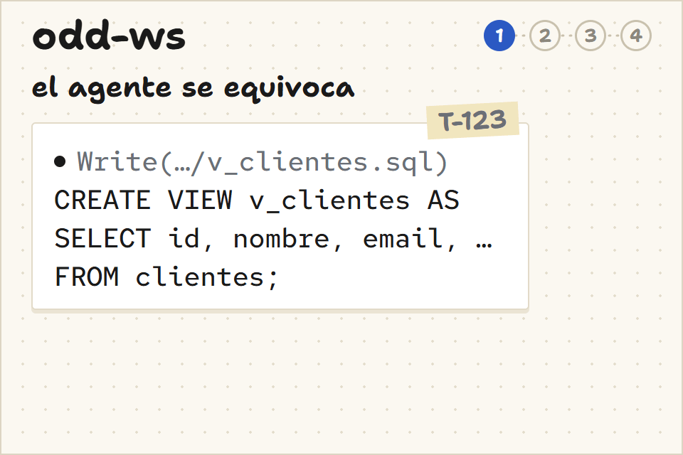
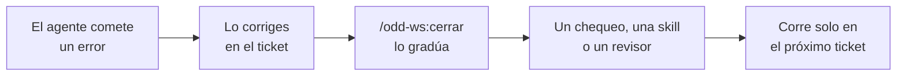

# odd-workspace-template

[](https://github.com/sebasgc0399/odd-workspace-template/actions/workflows/pruebas.yml)
[](LICENSE)



**Que tu agente no vuelva a cometer el mismo error.** `odd-ws` es un plugin para Claude Code, Codex CLI y gentle-shell (Pi) que convierte lo que aprendes en un proyecto en chequeos que corren solos, en vez de notas que el agente tiene que recordar.

**Versión actual:** `0.10.1` ([qué cambió en cada versión](CHANGELOG.md)).

## Cómo funciona

Una convención que solo vive como texto depende de que el modelo la recuerde. `odd-ws` sigue el principio *Mecanismo > Memoria*: lo que se aprende se vuelve un chequeo, no un recordatorio.



## Qué te da

El plugin monta una **instancia**, un espacio de trabajo con agentes, en una carpeta aparte, al lado de tus repos de código. La instancia tiene su propio git y apunta a tus repos por su ruta, sin tocarlos:

- **Cada ticket tiene su carpeta,** con su objetivo, sus criterios de aceptación y su alcance.
- **Los hooks chequean cada edición** contra las reglas de su capa, y frenan los comandos peligrosos.
- **Los cambios grandes los escriben agentes con compuerta,** y los revisores dejan un recibo atado al diff.
- **Lo aprendido en un ticket sube** a reglas y docs verificables.
- **Las reglas de un stack se pueden traer de otro repo git,** fijadas a una etiqueta, con `/odd-ws:paquetes`.

## Así se ve un bloqueo

Tu agente intenta `git push --force origin main`. El hook de comandos lo frena antes de que corra, y el agente recibe este mensaje:

```text
guard-comandos bloqueó el comando: git push --force (si de verdad hace falta forzar, usa --force-with-lease). Si la operación es deliberada, que la corra el usuario a mano.
```

Lo mismo vale para tu stack: si el agente no cargó los no-negociables de una capa, su primera edición ahí se bloquea y los recibe, y después de cada edición corren las reglas de la capa. El detalle está en [Hooks](Doc/hooks.md).

## Junto a gentle-ai y engram

`odd-ws` no reemplaza a ninguno de los dos: cada uno cubre una parte distinta, y ninguno es obligatorio. Se pisan en una sola cosa, la revisión, y solo dentro de una instancia: ahí revisa `odd-ws`.

| Herramienta | De qué se encarga |
|---|---|
| gentle-ai | Cómo trabaja el agente: el flujo, la delegación y la revisión |
| engram | Qué recuerda el agente entre sesiones |
| odd-ws | Qué se exige en cada proyecto, con lo aprendido convertido en chequeos |

- **Con engram,** `/odd-ws:cerrar` lee las memorias del proyecto y te muestra cuáles vale la pena convertir en reglas.
- **Con gentle-ai,** el doctor te propone apagar su revisión nativa (`rdd`) solo en el clon de la instancia, porque ahí la instancia trae revisores propios que leen el repo y las reglas de cada capa. Tus otros proyectos siguen con la revisión de gentle-ai, y el doctor nunca la apaga solo.

## Instalación

Este repo es un marketplace con un solo plugin, `odd-ws`. Revisa los requisitos y abre la guía de tu CLI.

| Herramienta | Versión |
|---|---|
| Python, invocable como `python3` | 3.7 o más. El doctor pide 3.11 o más para leer la config de Codex |
| Git | En Windows, Git for Windows |
| Claude Code | 2.1.284 o más; se recomienda 2.1.295 o más |
| Codex CLI, si lo usas | 0.144 o más; 0.167 o más para los writers |
| Pi, si lo usas | 1.5.0 o más. En Windows, sus hooks lanzan `python` |
| gentle-shell, para los writers en Pi | El de `npm i -g gentle-pi`. Sin él, Pi corre los guards, pero no los writers |

En Windows, `python3` lo crean el Python install manager de python.org y la Microsoft Store, no el instalador clásico. El detalle y las herramientas opcionales están en [Requisitos de la máquina](Doc/uso.md#requisitos-de-la-máquina).

<details open>
<summary><strong>Con Claude Code</strong></summary>

1. **Instala el plugin** desde la carpeta de la instancia: una carpeta aparte, no la de tu repo de código (puede estar vacía). `--scope project` es obligatorio: sin él, los hooks correrían en todos tus proyectos.

   ```text
   claude plugin marketplace add sebasgc0399/odd-workspace-template
   claude plugin install odd-ws@odd-workspace-template --scope project
   ```

   Si `marketplace add` falla con «its source doesn't match its extraKnownMarketplaces entry», el marketplace ya está registrado con otra fuente (por ejemplo, la URL git completa). No hace falta registrarlo de nuevo: sigue con `plugin install`.

2. **Abre `claude` en esa carpeta y corre `/odd-ws:bootstrap`.** Detecta tus repos, te muestra la propuesta completa (proyecto, repos y capas) junto con el plan y solo escribe después de tu sí, con el primer commit incluido.
3. **Corre `/odd-ws:doctor`,** arregla lo que marque FALTA y abre tu primer ticket con `/odd-ws:abrir`.

Antes de tu primer ticket, lee las [reglas de la instalación](Doc/uso.md#reglas-de-la-instalación): cada ticket lleva su `.claude/settings.json` y su sesión se abre con `--add-dir`.

</details>

<details>
<summary><strong>Con Codex CLI</strong></summary>

Codex trabaja sobre la misma instancia: `.claude/` sigue siendo la fuente, y Codex recibe sus propios archivos generados. Una instancia puede usarse con los dos CLI a la vez.

1. **Declara Codex en la instancia:** `"hosts": ["claude-code", "codex"]` en `workspace.config.json`. En una instancia nueva, el bootstrap te lo pregunta si mencionas Codex.
2. **Instala el plugin en Codex:**

   ```text
   codex plugin marketplace add sebasgc0399/odd-workspace-template
   codex plugin add odd-ws@odd-workspace-template
   ```

3. **Abre `codex` en la raíz de la instancia,** acepta confiar en la carpeta y confía los hooks de `odd-ws` cuando Codex lo pida, o desde `/hooks`. Las skills se invocan con `$`, por ejemplo `$doctor`.

Para sumar Codex a una instancia que ya existe, o configurar los writers en Windows, ve a [Usarlo desde Codex](Doc/uso.md#usarlo-desde-codex).

</details>

<details>
<summary><strong>Con gentle-shell (Pi)</strong></summary>

gentle-shell es Pi con subagentes, y trabaja sobre la misma instancia: `.claude/` sigue siendo la fuente, y Pi recibe sus agentes generados en `.pi/agents`.

1. **Declara Pi en la instancia:** `"hosts": ["claude-code", "pi"]` en `workspace.config.json`, o solo `["pi"]`. En una instancia que ya existe, los agentes de `.pi/agents` los genera el doctor en el paso 4.
2. **Instala gentle-shell y el paquete de `odd-ws`.** gentle-shell se instala con `npm i -g gentle-pi`. El paquete de `odd-ws` no está en npm: se instala desde git, con la etiqueta de la versión, o desde la raíz de un clon del repo.

   ```text
   gentle-shell install git:github.com/sebasgc0399/odd-workspace-template@odd-ws--v<versión>
   gentle-shell install <ruta del clon>
   ```

   La ruta es la raíz del clon, no `plugin/`, porque Pi instala un repo git entero. Con la fuente git, Pi corre `npm install`, así que necesita `npm` en el `PATH`. Si abres gentle-shell con `--link`, instala con `gentle-shell --link install <fuente>`.
3. **Abre gentle-shell en la raíz de la instancia** y dale confianza al proyecto con `/trust`. gentle-shell solo lee los agentes de `<cwd>/.pi/agents`, y sin confianza no llegan las skills de la instancia.
4. **Corre `/skill:doctor`.** En Pi, las skills del plugin se invocan con `/skill:<nombre>`. El doctor revisa la versión de Pi, gentle-shell, el paquete del home activo, la confianza del proyecto y los agentes de `.pi/agents`; en una instancia que ya existía, aplica `--arreglar pi-agentes`.

Antes de lanzar un writer, lee [Usarlo desde gentle-shell](Doc/uso.md#usarlo-desde-gentle-shell): ahí está dónde corre el writer, qué herramientas cubren los guards y qué hacer si el doctor no arranca. Para pasar a otra versión, ve a [Actualizar el plugin](Doc/actualizar.md#en-gentle-shell-pi).

</details>

## Dónde funciona

| CLI | Windows | Linux | macOS |
|---|---|---|---|
| Claude Code | Uso diario del autor, y el CI | Solo el CI | Solo el CI |
| Codex CLI | Prueba de humo a mano con la 0.144 y la 0.167, y el CI | Solo el CI | Solo el CI |
| gentle-shell (Pi) | Prueba de humo a mano con gentle-shell 4.8.0 y Pi 1.5.2, y el CI | Solo el CI | Solo el CI |

El CI (`.github/workflows/pruebas.yml`) corre todas las suites en Ubuntu, Windows y macOS. No instala ningún CLI. En Linux y macOS nadie lo probó a mano todavía.

<details>
<summary><strong>Limitaciones conocidas</strong></summary>

- **Codex en Windows:** los writers necesitan `[windows] sandbox` en la config de Codex. Con el sandbox `unelevated`, la medición de líneas del writer da 0/0 (pendiente X7). Afecta solo esa medición, no los bloqueos.
- **Si Python no arranca:** con Claude Code 2.1.295 o más, y en Pi, la herramienta se bloquea con el error. Con una versión anterior de Claude Code, y siempre en Codex, la herramienta pasa sin el chequeo.

</details>

## Documentación

| Si quieres… | Lee |
|---|---|
| Conocer los conceptos, el ciclo de un ticket y cada skill | [Doc/uso.md](Doc/uso.md) |
| Entender por qué el agente frenó una edición o un comando | [Doc/hooks.md](Doc/hooks.md) |
| Escribir reglas para tu stack, o traerlas de otro repo como paquete | [Doc/capas-y-reglas.md](Doc/capas-y-reglas.md) |
| Compartir una instancia con tu equipo | [Doc/equipo.md](Doc/equipo.md) |
| Actualizar el plugin | [Doc/actualizar.md](Doc/actualizar.md) |
| Saber qué cambió en cada versión | [CHANGELOG.md](CHANGELOG.md) |
| Modificar la plantilla misma | [CONTRIBUTING.md](CONTRIBUTING.md) |
| Conocer el porqué de cada decisión | [Doc/diseno.md](Doc/diseno.md) |

## Licencia

[MIT](LICENSE).
