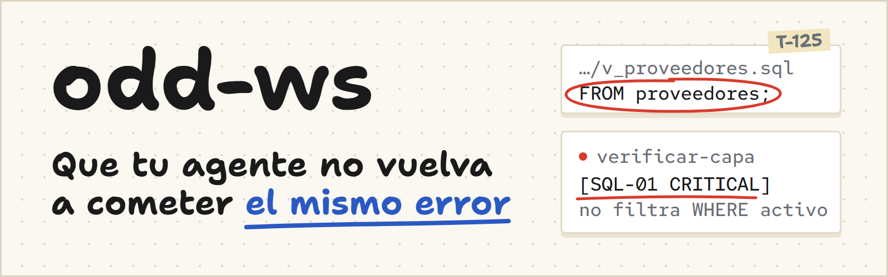
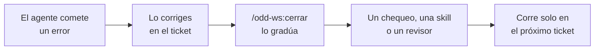

# 

[](https://github.com/sebasgc0399/odd-workspace-template/actions/workflows/pruebas.yml)
[](LICENSE)

**Que tu agente no vuelva a cometer el mismo error.** `odd-ws` es un plugin que convierte lo que le corriges al agente en un proyecto en chequeos que corren solos, en vez de notas que tiene que recordar.

**Funciona con** Claude Code · Codex CLI · gentle-shell (Pi)

**Versión actual:** `0.20.0` ([qué cambió en cada versión](CHANGELOG.md)).

[Inicio rápido](#inicio-rápido) · [Instalación](#instalación) · [Guía de uso](Doc/uso.md) · [Página del proyecto](https://sebasgc0399.github.io/odd-workspace-template/) · [La instalación en video](https://youtu.be/-92eWjnwjtw)

## Inicio rápido

Con Claude Code, en tres pasos:

1. **Instala el plugin** desde una carpeta aparte, al lado de tus repos de código (puede estar vacía). Esa carpeta va a ser la instancia.

   ```text
   claude plugin marketplace add sebasgc0399/odd-workspace-template
   claude plugin install odd-ws@odd-workspace-template --scope project
   ```

2. **Abre `claude` en esa carpeta y corre `/odd-ws:bootstrap`.** Te muestra la propuesta completa y solo escribe después de tu sí.
3. **Corre `/odd-ws:doctor`** y abre tu primer ticket con `/odd-ws:abrir`.

¿Usas Codex o gentle-shell? Sigue su guía: [Codex CLI](#con-codex-cli) o [gentle-shell (Pi)](#con-gentle-shell-pi).


*Un ejemplo del ciclo, armado con un ticket de prueba: no es una grabación.*

## Cómo funciona

Le corriges algo al agente y, en la sesión siguiente, lo repite: la corrección quedó en el chat. `odd-ws` sigue el principio *Mecanismo > Memoria*: cuando cierras el ticket, esa corrección se vuelve un chequeo en tu repo, y corre solo en el próximo.



Cuatro palabras que vas a ver en todo el proyecto:

| Palabra | Qué es |
|---|---|
| Instancia | Una carpeta aparte, al lado de tus repos, con su propio git: tickets, reglas y agentes. Apunta a tus repos por su ruta |
| Ticket | La carpeta de una tarea, con su objetivo, sus criterios de aceptación y su alcance |
| Capa | Una tecnología de tu proyecto (SQL, C#, Android…) con sus reglas |
| Regla | Una corrección convertida en chequeo. Avisa hasta que se calibra contra tu código; después bloquea |

### Así se ve un bloqueo

Tu agente intenta `git push --force origin main`. El hook de comandos lo frena antes de que corra, y el agente recibe este mensaje:

> guard-comandos bloqueó el comando: git push forzado (no lo corras tú: un lease sin `ref:sha` lo satisface cualquier `fetch`; para forzar con seguridad, el usuario mira `git log <remoto>/<rama>` y corre `git push --force-with-lease=<rama>:<sha que esperas> <remoto> <rama>`). Si la operación es deliberada, que la corra el usuario a mano.<br>
> Comando: «git push --force origin main»

Lo mismo vale para tu stack: si el agente no cargó los no-negociables de una capa, su primera edición ahí se bloquea y los recibe, y después de cada edición corren las reglas de la capa. El detalle está en [Hooks](Doc/hooks.md).

## Qué te da

- **Cada ticket tiene su carpeta,** con su objetivo, sus criterios de aceptación y su alcance. `/odd-ws:abrir` y `/odd-ws:cerrar` commitean en la instancia; con `ask_before_commit` en la config, te preguntan antes.
- **Los hooks revisan cada edición y cada comando.** Corren las reglas de la capa del archivo y frenan los comandos peligrosos, también cuando el agente escribe por la shell. Frenan errores y atajos, no a un agente que los esquiva a propósito: para eso está el sandbox de tu sistema. Fuera de una instancia, dejan pasar todo.
- **Las reglas empiezan observando.** Una instancia nueva arranca sin reglas: se suman cuando cierras tickets, o las traes de otro repo con `/odd-ws:paquetes`. Una regla avisa hasta que se calibra contra tu código, y recién ahí bloquea. Si un bloqueo es un falso positivo, una disputa la vuelve aviso hasta que se arregle su chequeo. Si actualizas desde una versión anterior a la `0.12.0`, calibra tus reglas ([cómo](Doc/actualizar.md#después-de-actualizar-calibrar-las-reglas-que-bloquean)).
- **Los cambios grandes los escriben agentes con compuerta,** y los revisores dejan un recibo atado al diff. La revisión mide cuánto cuesta y explica por qué eligió su modo.
- **Lo aprendido en un ticket sube** a reglas y docs verificables.
- **Puedes apagar un hook puntual** con `disabled_hooks` en la config, sin desinstalar el plugin ([Hooks](Doc/hooks.md)).

## Por dónde empezar

| Si ya usas… | Haz esto |
|---|---|
| Solo Claude Code | Instala el plugin completo y corre `/odd-ws:bootstrap` ([Inicio rápido](#inicio-rápido)) |
| gentle-ai | Si quieres conservar su revisión, elige en el bootstrap el perfil `controles`: solo guards, reglas por capa y doctor. Si no, el perfil completo, y el doctor te propone apagar su revisión solo en el clon de la instancia ([más abajo](#junto-a-gentle-ai-y-engram)) |
| Codex o gentle-shell (Pi) | Crea la instancia con su bootstrap (`$bootstrap` o `/skill:bootstrap`) y sigue su guía ([Codex](#con-codex-cli) o [gentle-shell](#con-gentle-shell-pi)) |

## Instalación

Este repo es un marketplace con un solo plugin, `odd-ws`. Revisa los requisitos y sigue la guía de tu CLI.

En video: [la instalación con Claude Code, paso a paso](https://youtu.be/-92eWjnwjtw), en 5 minutos y en español.

| Herramienta | Versión |
|---|---|
| Python, invocable como `python3` | 3.7 o más. El doctor pide 3.11 o más para leer la config de Codex |
| Git | En Windows, Git for Windows |
| Claude Code | 2.1.284 o más; se recomienda 2.1.295 o más |
| Codex CLI, si lo usas | 0.144 o más; 0.167 o más para los writers. En Windows, sus hooks lanzan `python` |
| Pi, si lo usas | 1.5.0 o más. En Windows, sus hooks lanzan `python` |
| gentle-shell, para los writers en Pi | El de `npm i -g gentle-pi`. Sin él, Pi corre los guards, pero no los writers |

En Windows, `python3` lo crean el Python install manager de python.org y la Microsoft Store, no el instalador clásico. El detalle y las herramientas opcionales están en [Requisitos de la máquina](Doc/uso.md#requisitos-de-la-máquina).

### Con Claude Code

1. **Instala el plugin** desde la carpeta de la instancia: una carpeta aparte, no la de tu repo de código (puede estar vacía).

   ```text
   claude plugin marketplace add sebasgc0399/odd-workspace-template
   claude plugin install odd-ws@odd-workspace-template --scope project
   ```

   **`--scope project` es obligatorio:** sin él, los hooks correrían en todos tus proyectos. Si `marketplace add` falla con «its source doesn't match its extraKnownMarketplaces entry», el marketplace ya está registrado con otra fuente (por ejemplo, la URL git completa). No hace falta registrarlo de nuevo: sigue con `plugin install`.

2. **Abre `claude` en esa carpeta y corre `/odd-ws:bootstrap`.** Toma tus repos del `.code-workspace` o te pregunta cuáles son, te muestra la propuesta completa (proyecto, repos y capas) junto con el plan y solo escribe después de tu sí, con el primer commit incluido.
3. **Corre `/odd-ws:doctor`,** arregla lo que marque FALTA y abre tu primer ticket con `/odd-ws:abrir`.

Antes de tu primer ticket, lee las [reglas de la instalación](Doc/uso.md#reglas-de-la-instalación): cada ticket lleva su `.claude/settings.json` y su sesión se abre con `--add-dir`.

### Con Codex CLI

Codex trabaja sobre la misma instancia: `.claude/` sigue siendo la fuente, y Codex recibe sus propios archivos generados. Una instancia puede usarse con los dos CLI a la vez.

1. **Instala el plugin en Codex:**

   ```text
   codex plugin marketplace add sebasgc0399/odd-workspace-template
   codex plugin add odd-ws@odd-workspace-template
   ```

2. **Crea o completa la instancia.** En una carpeta nueva, abre `codex` y corre `$bootstrap`: si mencionas Codex, te pregunta los hosts. En una instancia que ya existe, declara Codex en `workspace.config.json` con `"hosts": ["claude-code", "codex"]`, o solo `["codex"]`, y corre el doctor con `--arreglar codex-config` y `--arreglar codex-agentes`.
3. **Abre `codex` en la raíz de la instancia,** acepta confiar en la carpeta y confía los hooks de `odd-ws` cuando Codex lo pida, o desde `/hooks`. Las skills se invocan con `$`, por ejemplo `$doctor`.

Para sumar Codex a una instancia que ya existe, o configurar los writers en Windows, ve a [Usarlo desde Codex](Doc/uso.md#usarlo-desde-codex).

### Con gentle-shell (Pi)

gentle-shell es Pi con subagentes, y trabaja sobre la misma instancia: `.claude/` sigue siendo la fuente, y Pi recibe sus agentes generados en `.pi/agents`.

1. **Instala gentle-shell y el paquete de `odd-ws`.** El paquete no está en npm: se instala desde git, con la etiqueta de la versión actual.

   ```text
   npm i -g gentle-pi
   gentle-shell install git:github.com/sebasgc0399/odd-workspace-template@odd-ws--v0.20.0
   ```

   Desde un clon: `gentle-shell install <ruta del clon>`. La ruta es la raíz del clon, no `plugin/`, porque Pi instala un repo git entero. Con la fuente git, Pi corre `npm install`, así que necesita `npm` en el `PATH`. Si abres gentle-shell con `--link`, instala con `gentle-shell --link install <fuente>`.
2. **Crea o completa la instancia.** En una carpeta nueva, abre gentle-shell y corre `/skill:bootstrap`. En una instancia que ya existe, declara Pi en `workspace.config.json` con `"hosts": ["claude-code", "pi"]`, o solo `["pi"]`; los agentes de `.pi/agents` los genera el doctor en el paso 4.
3. **Abre gentle-shell en la raíz de la instancia** y dale confianza al proyecto con `/trust`. gentle-shell solo lee los agentes de `<cwd>/.pi/agents`, y sin confianza no llegan las skills de la instancia.
4. **Corre `/skill:doctor`.** En Pi, las skills del plugin se invocan con `/skill:<nombre>`. El doctor revisa la versión de Pi, gentle-shell, el paquete del home activo, la confianza del proyecto y los agentes de `.pi/agents`; en una instancia que ya existía, aplica `--arreglar pi-agentes`.

Antes de lanzar un writer, lee [Usarlo desde gentle-shell](Doc/uso.md#usarlo-desde-gentle-shell): ahí está dónde corre el writer, qué herramientas cubren los guards y qué hacer si el doctor no arranca. Para pasar a otra versión, ve a [Actualizar el plugin](Doc/actualizar.md#en-gentle-shell-pi).

## Las skills

| Comando | Para qué |
|---|---|
| `/odd-ws:bootstrap` | Crear la instancia, o completar una que ya existe |
| `/odd-ws:doctor` | Revisar tu máquina y la instancia, y decir cómo arreglar lo que falta |
| `/odd-ws:abrir` | Empezar un ticket |
| `/odd-ws:revisar` | Revisar un cambio antes del commit |
| `/odd-ws:cerrar` | Cerrar un ticket y graduar lo aprendido; con `memorias`, las del proyecto |
| `/odd-ws:paquetes` | Traer, listar, cambiar de etiqueta o sacar las reglas de otro repo |
| `/odd-ws:enlaces` | Revisar, abrir y copiar los enlaces de un ticket o de cualquier `.md` |
| `/odd-ws:conocimiento` | Revisar la salud de los docs del proyecto (con la clave `knowledge` en la config) |
| `/odd-ws:eval-reviewers` | Medir un revisor contra la revisión real de un líder |

Cuándo usar cada una y quién la dispara está en la [guía de uso](Doc/uso.md#skills).

## Junto a gentle-ai y engram

`odd-ws` no reemplaza a ninguno de los dos: cada uno cubre una parte distinta, y ninguno es obligatorio. Se pisan en una sola cosa, la revisión, y solo dentro de una instancia: ahí revisa `odd-ws`.

| Herramienta | De qué se encarga |
|---|---|
| gentle-ai | Cómo trabaja el agente: el flujo, la delegación y la revisión |
| engram | Qué recuerda el agente entre sesiones |
| odd-ws | Qué se exige en cada proyecto, con lo aprendido convertido en chequeos |

- **Con engram,** `/odd-ws:cerrar memorias` suma las memorias del proyecto a la propuesta y te muestra cuáles vale la pena convertir en reglas.
- **Con gentle-ai,** en el perfil completo el doctor te propone apagar su revisión nativa (`rdd`) solo en el clon de la instancia, porque ahí la instancia trae revisores propios que leen el repo y las reglas de cada capa. Lo aplica con tu sí (`--arreglar rdd`), nunca solo, y tus otros proyectos siguen con la revisión de gentle-ai.
- **Si prefieres quedarte con la revisión de gentle-ai,** el bootstrap te ofrece el perfil `controles`: solo los guards, las reglas por capa y el doctor, sin tickets, writers ni la revisión de `odd-ws`. Ahí no se pisan, y el doctor no te propone apagar el RDD. Ver [El perfil `controles`](Doc/uso.md#el-perfil-controles).

## Dónde funciona

| CLI | Windows | Linux | macOS |
|---|---|---|---|
| Claude Code | Uso diario del autor, y el CI | Solo el CI | Solo el CI |
| Codex CLI | Prueba de humo a mano con la 0.144 y la 0.167, y el CI | Solo el CI | Solo el CI |
| gentle-shell (Pi) | Prueba de humo a mano con gentle-shell 4.8.0 y Pi 1.5.2, y el CI | Solo el CI | Solo el CI |

El CI (`.github/workflows/pruebas.yml`) corre todas las suites en Ubuntu, Windows y macOS. No instala ningún CLI. En Linux y macOS nadie lo probó a mano todavía.

<details>
<summary><strong>Limitaciones conocidas</strong></summary>

- **Codex en Windows:** los writers necesitan `[windows] sandbox` en la config de Codex. Con el sandbox `unelevated`, la medición de líneas del writer da 0/0 (pendiente X7). Afecta solo esa medición, no los bloqueos.
- **Si Python no arranca:** con Claude Code 2.1.295 o más, y en Pi, la herramienta se bloquea con el error. Con una versión anterior de Claude Code, y siempre en Codex, la herramienta pasa sin el chequeo.

</details>

## Documentación

| Si quieres… | Lee |
|---|---|
| Conocer los conceptos, el ciclo de un ticket y cada skill | [Doc/uso.md](Doc/uso.md) |
| Entender por qué el agente frenó una edición o un comando | [Doc/hooks.md](Doc/hooks.md) |
| Escribir reglas para tu stack, o traerlas de otro repo como paquete | [Doc/capas-y-reglas.md](Doc/capas-y-reglas.md) |
| Compartir una instancia con tu equipo | [Doc/equipo.md](Doc/equipo.md) |
| Actualizar el plugin | [Doc/actualizar.md](Doc/actualizar.md) |
| Saber qué cambió en cada versión | [CHANGELOG.md](CHANGELOG.md) |
| Modificar la plantilla misma | [CONTRIBUTING.md](CONTRIBUTING.md) |
| Conocer el porqué de cada decisión | [Doc/diseno.md](Doc/diseno.md) |

## Licencia

[MIT](LICENSE).
